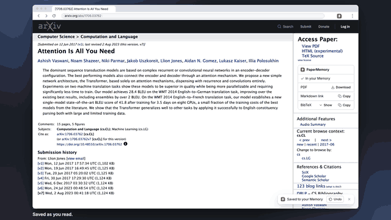
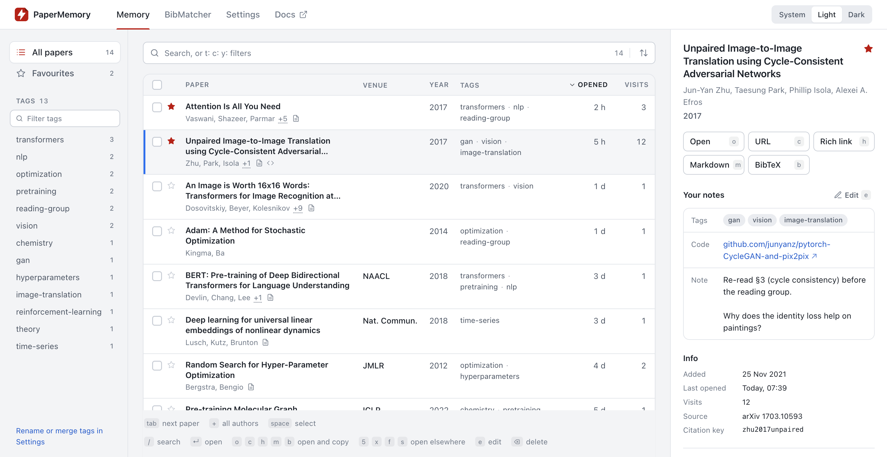

    

# PaperMemory

    <a href="https://chromewebstore.google.com/detail/paper-memory/hmebhknlgddhfbbdhgplnillngljgmdi">
        <strong>Chrome, Brave & Edge</strong>
    </a>
    &nbsp;•&nbsp;
    <a href="https://addons.mozilla.org/en-US/firefox/addon/paper-memory/">
        <strong>Firefox</strong>
    </a>
    &nbsp;•&nbsp;
    <a href="https://papermemory.org">
        <strong>papermemory.org</strong>
    </a>

PaperMemory keeps a record of the research papers you read. Open a paper on a supported site and it is saved to your Memory with its title, authors, venue, year, links and BibTeX. No clicks, no account, no server. You can then search it, tag it, add a note and copy a citation, from the popup or from a full-page view. It complements reference managers such as Zotero: it keeps every paper you open, without being asked.

    

## Papers are saved as you read

- Papers are saved when you open them on arXiv, OpenReview, NeurIPS, PMLR, ACL Anthology, CVF, Nature, Science, IEEE, ACM, Springer, bioRxiv, PubMed Central and 18 other publishers and archives. Abstract pages and PDFs both work.
- A small notice on the page confirms the save, with an Undo.
- Any other web page (a blog post, a documentation page) can be added by hand from the popup.

The full list of 31 Sources is on [papermemory.org](https://papermemory.org/features/#venues).

## Find any paper in seconds

- Search titles, authors, notes, tags, IDs and venues as you type.
- Filter by tag (`t:`), year (`y:`) or code link (`c:`). Filters become pills and combine with free text.
- Tags, a note, a code link and a favourite star on every paper.

## Cite with one key

- Copy a paper's BibTeX (`b`), Markdown link (`m`), rich link (`h`) or URL (`c`) from the popup.
- Export your Memory, or the papers with a given tag, as a `.bib` file.

## The full-page Memory

- Your whole Memory in its own tab: a table, a tag list and a detail pane.
- Select several papers and act on them at once: add a tag, favourite, copy BibTeX, export `.bib`, delete.

    

## Cite the published version, not the preprint

- For arXiv preprints, PaperMemory looks for the published version on DBLP, Semantic Scholar, CrossRef, OpenAlex and Google Scholar. It shows the venue when it finds one.
- BibMatcher: give it a `.bib` file and it proposes the published version of each preprint (arXiv, bioRxiv, medRxiv, ChemRxiv). You accept or reject every change, and your citation keys can be kept.

## On paper pages

- On arXiv, the PaperMemory block shows whether the paper is in your Memory, with BibTeX, a Markdown link, a PDF download and the published venue.
- PDF tabs are renamed with the paper's title instead of a file name such as `1706.03762.pdf`.
- PDFs can be downloaded with a readable name into a `PaperMemoryStore` folder in your Downloads. On arXiv, the block then shows the file in its folder.
- Open an arXiv paper on ar5iv, alphaXiv, Hugging Face or SciRate with one key.

## Your data stays yours

- Your Memory lives in your browser's extension storage. There is no PaperMemory account and no PaperMemory server.
- No analytics, no tracking.
- To fill in a paper's details, PaperMemory sends only that paper's title or identifier to academic services. Your notes and tags are never sent.
- Optional sync: with a GitHub token you provide, your Memory is copied to a private Gist in your own account. Off by default.
- Export a full JSON backup at any time, and import it back.

## Documentation

- [Getting started](https://papermemory.org/getting-started/)
- [Install from source](https://papermemory.org/getting-started/#from-source)
- [Keyboard shortcuts](https://papermemory.org/configuration/#keyboard-shortcuts)
- [The options page](https://papermemory.org/configuration/#options-page)
- [Preprint matching](https://papermemory.org/features/#preprint-matching)
- [Privacy](https://papermemory.org/features/#privacy)
- [FAQ](https://papermemory.org/faq/)

## Contributing and feedback

Bug reports, feature ideas and new Sources are welcome in the [issues](https://github.com/vict0rsch/PaperMemory/issues). PaperMemory is free and open source (MIT).
