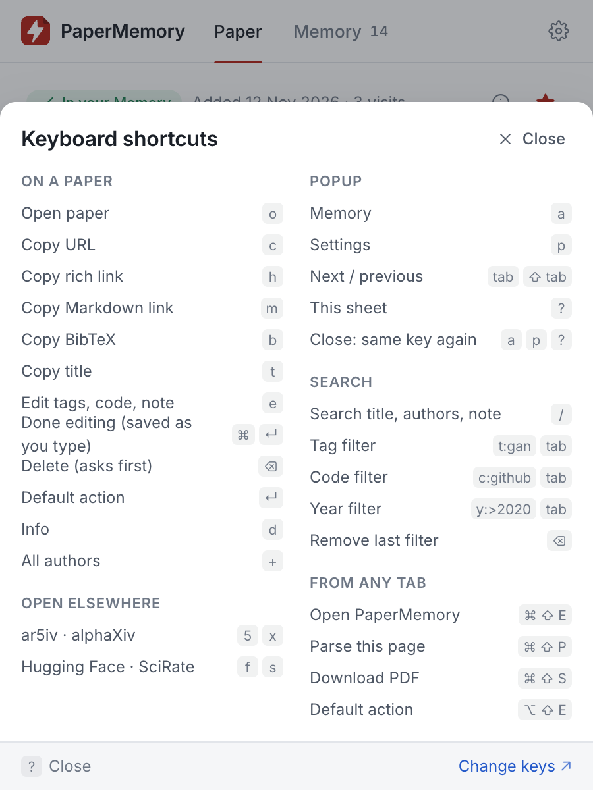
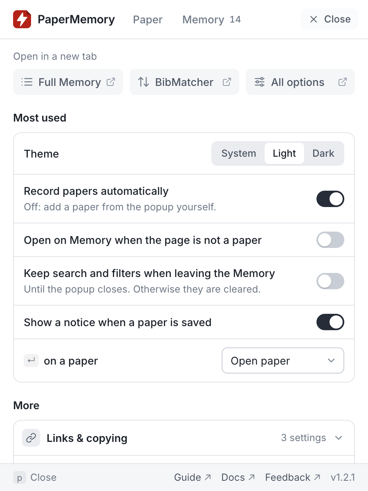
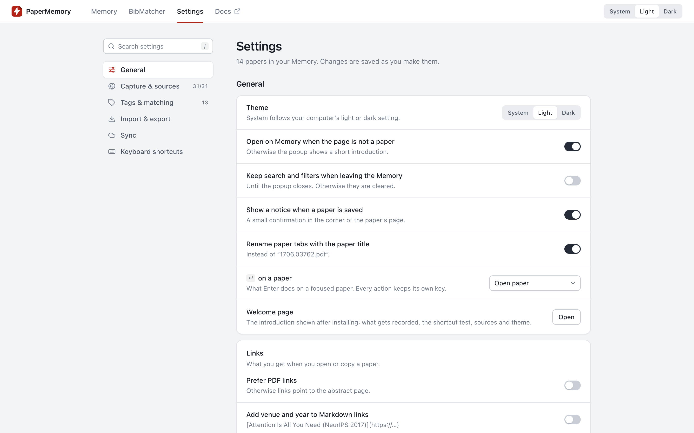
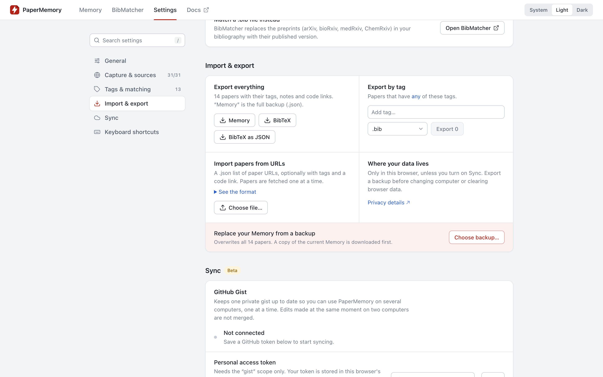
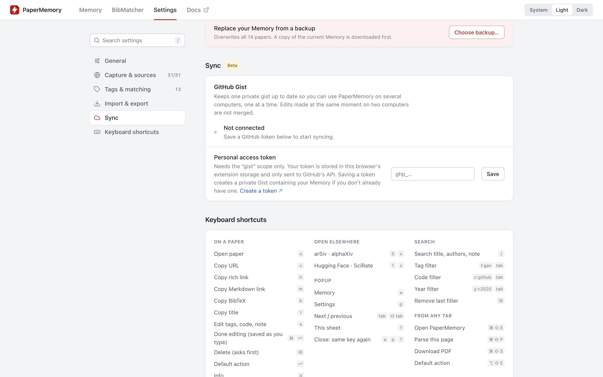

# Configuring PaperMemory

## Keyboard shortcuts

{ align=right .popup-display }

Press ++"?"++ in the popup to see every key. The same list is on the options page, in the _Keyboard shortcuts_ group (see [Keyboard](#keyboard)).

### From any tab

These shortcuts are set by your browser. The browser assigns the default keys only if no other extension already uses them.

| Action | Default keys |
| --- | --- |
| Open the popup | ++ctrl+shift+"E"++ (++cmd+shift+"E"++ on macOS, ++ctrl+shift+"M"++ on Linux) |
| Parse this page | ++ctrl+shift+"P"++ |
| Download the PDF | ++ctrl+shift+"S"++ |
| Default action | ++alt+shift+"E"++ |

On macOS, ++ctrl++ in the other shortcuts is ++cmd++ too.

- **Parse this page** records the paper of the current tab. Use it when automatic recording is off (see [Capture](#capture)).
- **Download the PDF** downloads the current paper's PDF if it is in your Memory. With _Keep downloaded PDFs_ on, the file goes to `Downloads/PaperMemoryStore/`.
- **Default action** runs, on the current paper's page, the action you chose for ++enter++ (see [General](#general)). Edit and Show info only work from the popup.

To change them:

- Chrome, Brave, Edge: open `chrome://extensions/shortcuts`.
- Firefox: open `about:addons`, click the gear icon, then _Manage Extension Shortcuts_.

The _Open browser shortcuts_ button on the options page and on the welcome tab takes you there. On Firefox versions that cannot open that screen from an extension, the button opens Mozilla's help page on extension shortcuts instead.

### In the popup

Keys do nothing while you type in a field.

| Key | Action |
| --- | --- |
| ++a++ | Open the Memory (press again to close it) |
| ++p++ | Open popup Settings (press again to close them) |
| ++"?"++ | Show the shortcut sheet (press again to close it) |
| ++tab++ / ++shift+tab++ | Next / previous paper |
| ++"/"++ | Search the Memory |

**On a paper** (the Paper tab, or the focused row in the Memory):

| Key | Action |
| --- | --- |
| ++"o"++ | Open the paper |
| ++"c"++ | Copy the URL |
| ++"h"++ | Copy a rich link (the title as a clickable link) |
| ++"m"++ | Copy a Markdown link |
| ++"b"++ | Copy the BibTeX |
| ++"t"++ | Copy the title |
| ++"e"++ | Edit tags, code link and note |
| ++ctrl+enter++ (++cmd+enter++ on macOS) | Done editing (changes are saved as you type) |
| ++backspace++ | Delete the paper (asks first) |
| ++enter++ | Default action (see [General](#general)) |
| ++"d"++ | Show info |
| ++"+"++ | Show all authors |
| ++"5"++ / ++"x"++ | Open on ar5iv / alphaXiv |
| ++"f"++ / ++"s"++ | Open on Hugging Face / SciRate |

The last two lines work on arXiv papers, when those links are turned on.

**In the search field:**

| Keys | Action |
| --- | --- |
| `t:gan` then ++tab++ | Add a tag filter |
| `c:github` then ++tab++ | Add a code link filter |
| `y:>2020` then ++tab++ | Add a year filter |
| ++backspace++ (empty field) | Remove the last filter |

### In the full-page Memory

The paper keys above work on the focused row. ++space++ selects a row, for actions on several papers at once.

## Popup Settings

{ align=right .popup-display }

Open popup Settings with the :octicons-gear-16: button or ++p++. The top row opens the full-page Memory, BibMatcher and the options page (_All options_) in a new tab. Every setting below is also on the [options page](#options-page).

**Most used**

- **Theme**: System, Light or Dark.
- **Record papers automatically**: when off, open the popup on a paper and add it yourself.
- **Open on Memory when the page is not a paper**
- **Keep search and filters when leaving the Memory**: until the popup closes.
- **Show a notice when a paper is saved**
- **↵ on a paper**: what ++enter++ does on a paper. Choose between edit, show info, open, copy URL, copy Markdown, copy BibTeX, copy rich link, or open on ar5iv, alphaXiv, Hugging Face or SciRate.

**Links & copying**

- **Prefer PDF links**: otherwise links point to the abstract page.
- **Add venue and year to Markdown links**
- **Open the downloaded PDF when there is one**: applies to ++"o"++ in the Memory.

**Recording**

- **Only record from PDF pages**: abstract pages are ignored.
- **Keep PDFs in Downloads/PaperMemoryStore**: reopen a file instead of downloading it again.
- **Parse any website** (experimental): adds a _Parse this page_ button to the popup. See [Adding any website](features.md#adding-any-website).

**Extra links in the popup**

- ar5iv, alphaXiv, Hugging Face papers (arXiv papers only) and SciRate.

**On paper pages**

- **Rename paper tabs with the paper title**
- **arXiv: direct PDF download button**, **arXiv: Markdown link section**, **arXiv: BibTeX section**: the rows of the [PaperMemory block](getting-started.md#papermemory-block).

## Options page

{ .advanced-screenshot }

The options page holds every setting. Open it in one of these ways:

- Click _All options_ in popup Settings.
- Right-click the PaperMemory icon in the toolbar and choose _Options_.
- Click _All settings_ at the bottom of the welcome tab.

Changes are saved as you make them. The search field at the top filters the settings; press ++"/"++ to focus it.

### General

- **Theme**: System, Light or Dark. System follows your computer's setting.
- **Open on Memory when the page is not a paper**: otherwise the popup shows a short introduction.
- **Keep search and filters when leaving the Memory**
- **Show a notice when a paper is saved**: a small confirmation in the corner of the paper's page.
- **Rename paper tabs with the paper title**: instead of a file name such as `1706.03762.pdf`.
- **↵ on a paper**: what ++enter++ does on a focused paper. Every action keeps its own key.
- **Welcome page**: open the [welcome tab](getting-started.md#welcome-tab) again.

**Links**

- **Prefer PDF links**, **Add venue and year to Markdown links**, **Open the downloaded PDF when there is one**: as in popup Settings.
- **Extra links in the popup**: ar5iv, alphaXiv, Hugging Face and SciRate, each with its own key.
- **Additions to arXiv pages**: PDF download button, Markdown link, BibTeX citation in the [PaperMemory block](getting-started.md#papermemory-block).

### Capture

On the options page this group is named _Capture & sources_.

- **Record papers automatically**: when off, open the popup on a paper and add it yourself, or use the _Parse this page_ shortcut.
- **Only record from PDF pages**: abstract pages are ignored.
- **Keep downloaded PDFs**: saved in `Downloads/PaperMemoryStore/` so a paper reopens without downloading again. See [PaperMemoryStore](features.md#papermemorystore).
- **Parse any website** (experimental): adds a _Parse this page_ button to the popup on pages that are not a known Source.
- **Sources**: the sites PaperMemory records papers from. Turning one off stops new recordings from it; papers already saved stay in your Memory.

Code links are added by hand on a paper, in its Code field. See [Code links](features.md#code-links).

### Tags & matching

- **Auto-tagging**: rules that tag new papers whose title or authors match a pattern (a regular expression, case-insensitive). Leave a field empty to match everything.
- **Tags**: rename a tag, merge tags that mean the same thing, or delete one. Changes apply to every paper with that tag. Filter the list, and sort it by use or A to Z.
- **Find published versions of preprints**: _Check preprints_ looks up the preprints in your Memory on DBLP, CrossRef, Semantic Scholar and OpenAlex, and asks before changing anything. See [Preprint matching](features.md#preprint-matching).
- **Match a .bib file instead**: opens [BibMatcher](getting-started.md#bibmatcher).

### Import & export

{ align=right .advanced-screenshot }

- **Export everything**: _Memory_ (the full backup, `.json`), _BibTeX_ (`.bib`) or _BibTeX as JSON_.
- **Export by tag**: the papers that have any (or all) of the chosen tags, as `.bib`, `.json` or `.json` (URLs only).
- **Import papers from URLs**: a `.json` list of paper URLs or DOIs (read from the publisher's page they lead to), optionally with tags and a code link. Papers are fetched one at a time. The expected format is shown on the page.
- **Replace your Memory from a backup**: overwrites all your papers with a `.json` backup. A copy of the current Memory is downloaded first.

See [BibTeX export](features.md#bibtex-export).

{ align=right .advanced-screenshot }

### Sync

Sync is in beta. It keeps one private GitHub Gist up to date so you can use PaperMemory on several computers, one at a time. Edits made at the same moment on two computers are not merged.

- Paste a GitHub **personal access token** with the `gist` scope only. The page links to GitHub's token form with that scope selected.
- Your token is stored in the browser's extension storage and only sent to GitHub's API.
- Saving a token creates a private Gist with your Memory if you do not already have one.
- Then use _Start syncing_, _Sync now_ or _Disconnect_.

See [Gist sync](features.md#gist-sync).

### Agent access

Off by default. Lets AI agents running on your computer, such as Claude Code or Codex, search your Memory and add papers to it. Turn it on once the agent tools are installed; the agents you allow are listed under **Paired clients**, each with a _Revoke_ button. See [Agent access](agents.md).

### Keyboard

On the options page this group is named _Keyboard shortcuts_. It lists every key, as in [Keyboard shortcuts](#keyboard-shortcuts) above, and has an _Open browser shortcuts_ button to change the keys that work from any tab.
