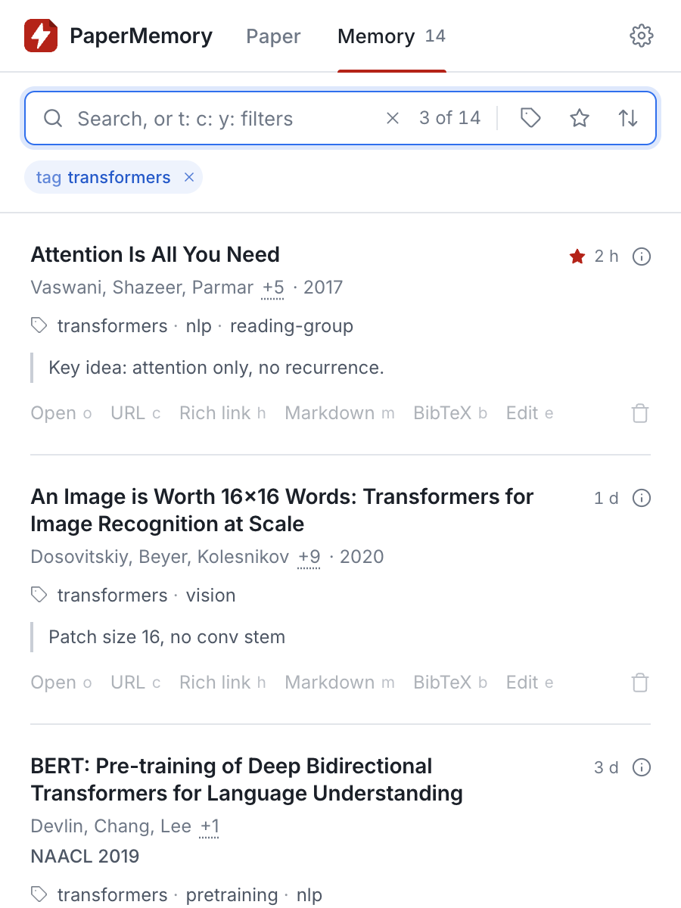
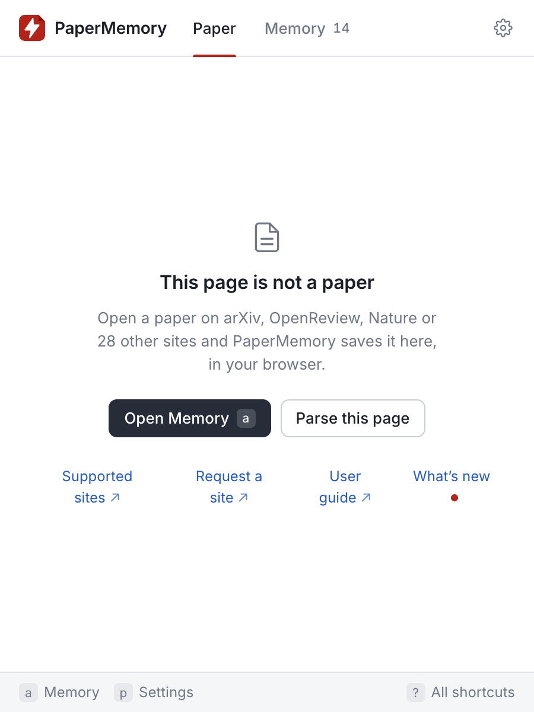
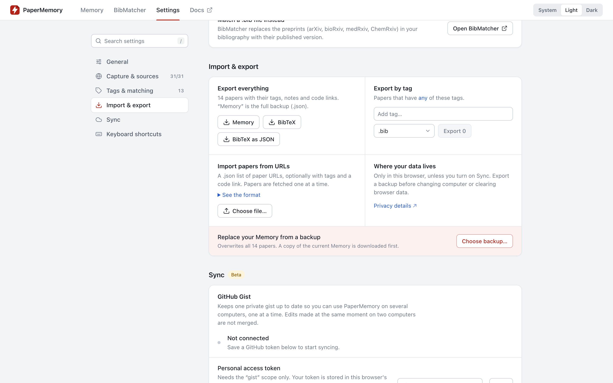
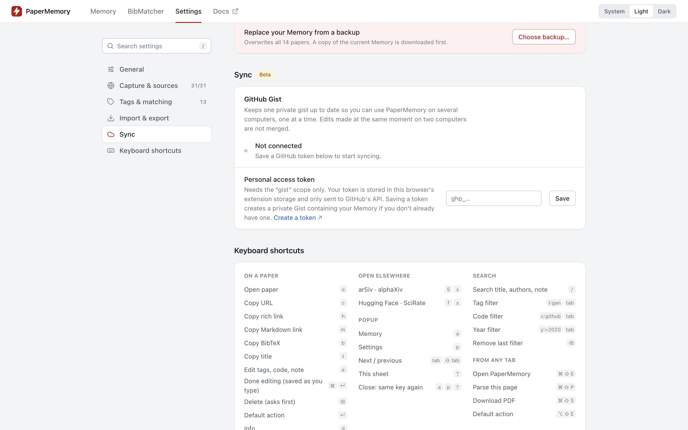
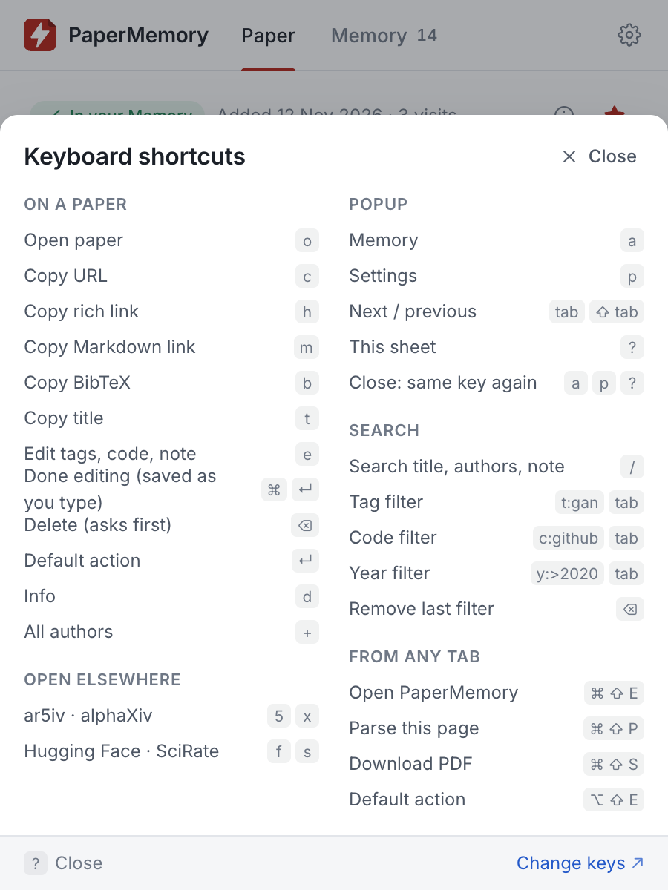

# Features

## Saving papers

Open a paper on a supported site and PaperMemory saves it to your Memory: title, authors, venue, year, links and BibTeX. The list of Sources is under [Venues](#venues).

- Abstract pages and PDFs both work. To save only from PDFs, turn on "Only record from PDF pages" in the [popup Settings](getting-started.md#popup-settings).
- A small notice in the corner of the page confirms the save. You can turn it off on the [options page](configuration.md#general).
- Opening a paper again does not create a duplicate: PaperMemory updates the paper, its last-opened date and its number of visits.
- To choose papers yourself, turn off "Record papers automatically" on the [options page](configuration.md#capture). You then add a paper from the popup, or with the "Parse this page" [keyboard shortcut](configuration.md#keyboard-shortcuts).
- You can turn individual Sources off on the [options page](configuration.md#capture), or when you pick them in the [welcome tab](getting-started.md#welcome-tab).
- On a paper's PDF, the browser tab shows the paper's title instead of a file name such as `1706.03762.pdf`.

## Venues

PaperMemory reads papers from these 31 Sources. Where a site has an open API, PaperMemory uses it; otherwise it reads the page. On a PDF, PaperMemory finds the abstract page from the PDF's URL. If a site's URLs do not allow that, the PDF is not saved.

??? info "Supported Sources"

    * arXiv, also from [alphaXiv](https://alphaxiv.org), [ar5iv](https://ar5iv.labs.arxiv.org), [Hugging Face papers](https://huggingface.co/papers) and [SciRate](https://scirate.com)
    * ACL Anthology (Association for Computational Linguistics)
    * ACM (Association for Computing Machinery)
    * ACS (American Chemical Society)
    * AIP (American Institute of Physics)
    * APS (American Physical Society)
    * bioRxiv
    * Cell
    * ChemRxiv
    * CVF (Computer Vision Foundation)
    * Frontiers
    * HAL
    * IEEE (Institute of Electrical and Electronics Engineers)
    * IHEP (INSPIRE - High Energy Physics)
    * IJCAI (International Joint Conferences on Artificial Intelligence)
    * IOP (Institute Of Physics)
    * JMLR (Journal of Machine Learning Research)
    * MDPI (Multidisciplinary Digital Publishing Institute)
    * Nature
    * NeurIPS (Neural Information Processing Systems)
    * OpenReview
    * OUP (Oxford University Press)
    * PLOS (Public Library of Science)
    * PMC (PubMed Central)
    * PMLR (Proceedings of Machine Learning Research)
    * PNAS (Proceedings of the National Academy of Sciences)
    * RSC (Royal Society of Chemistry)
    * Science
    * ScienceDirect
    * Springer
    * Wiley
    * [Request a site](https://github.com/vict0rsch/PaperMemory/issues/13)

A paper's venue is shown in a short form, such as `ICML 2023`, in the popup, the full-page Memory and the PaperMemory block. The full name is in the paper's Info panel (++d++). Short forms come from a table of known conferences and from standard journal abbreviations; PaperMemory does not invent abbreviations.

For preprints, PaperMemory also looks for the published version: see [Preprint matching](#preprint-matching).

## Searching

{ .popup-display }

The Memory search runs as you type, in the popup and in the [full-page Memory](getting-started.md#full-page-memory).

- Free text matches the title, authors, note, tags, ID and venue. Every word must match: `gan im` finds papers that contain both "gan" and "im".
- `t:` filters by tag, `y:` by year, `c:` by code link. Press ++tab++ or ++enter++ to turn a complete filter into a pill. Pills combine with each other and with free text. ++backspace++ in an empty search field removes the last pill.
    - `t:gan` keeps the papers tagged `gan`. While you type, `t:` also matches parts of tags.
    - `y:2020, 2021` keeps the papers from 2020 or 2021. `y:<2015` and `y:>2019` keep papers from strictly before or after a year. Two-digit years work: `y:>19`.
    - `c:github` keeps the papers whose code link contains "github".
- Show only your favourites with the star button.
- Sort by last opened, last added, year, title, number of visits or ID, in either direction.

## Preprint matching

There is no central record of which preprint became which publication. PaperMemory looks for the published version of a paper on public bibliographic services when the paper has no note or no venue yet. Papers from conference sites such as OpenReview, PMLR, NeurIPS or CVF get an `Accepted @ <venue>` note from the site itself.

When a published version is found:

- the paper's venue is set and shown in the popup, the full-page Memory and the PaperMemory block;
- if the paper has no note, a note `Accepted @ <venue> -- [<service>]` is added;
- the paper's BibTeX is updated with the publication's venue and year, and its DOI when the service has one. Preprint-only fields (such as `eprint` and `archiveprefix`) are removed. The citation key, title and authors are kept.

A preprint record (arXiv, bioRxiv, medRxiv, ChemRxiv) is never taken as the published version. Every service requires an exact title match, after ignoring case and punctuation.

??? example "How each service is used"

    All services are queried at the same time. The first one in this order that finds a match is used.

    * [Google Scholar](https://scholar.google.com)

        * PaperMemory searches the paper's title and opens the BibTeX export of the matching result.
        * The result is used if its journal is not a preprint server.
        * The note is `Accepted @ ${venue} -- [scholar.google.com]` and the paper's BibTeX becomes Google Scholar's entry.

    * [Semantic Scholar](https://www.semanticscholar.org)

        * A title query is sent to its [API](https://www.semanticscholar.org/product/api); the first 5 results are checked.
        * A match has the same title, a year within 2 years of the preprint's and a venue that is not a preprint server.
        * The venue is the conference's acronym when Semantic Scholar has a plausible one, otherwise an abbreviation of its venue name.
        * The note is `Accepted @ ${venue} (${year}) -- [semanticscholar.org]`.

    * [CrossRef](https://www.crossref.org)

        * A title query is sent to its [API](https://api.crossref.org/swagger-ui/index.html); the 5 best results are checked.
        * A match has the same title, a conference `event` name, a year within 2 years of the preprint's, and is not a preprint record. Journal articles have no event, so CrossRef only finds conference papers.
        * The note is `Accepted @ ${event.name} -- [crossref.org]`.
        * Try for instance [Attention-Guided Generative Adversarial Networks for Unsupervised Image-to-Image Translation](http://arxiv.org/pdf/1903.12296v3).

    * [dblp](https://dblp.org)

        * The query goes to its [SPARQL endpoint](https://sparql.dblp.org) (dblp's search API now answers programs with a bot check).
        * Records with the same title, a year within 2 years of the preprint's and a venue other than `CoRR` (arXiv) are kept; the oldest one is used.
        * Journal names are abbreviated with ISO 4 abbreviations.
        * The note is `Accepted @ ${venue} ${year} -- [dblp.org]`.
        * Try for instance [Domain-Adversarial Training of Neural Networks](http://arxiv.org/pdf/1505.07818v4).

    * [OpenAlex](https://openalex.org)

        * A title search is sent to its [API](https://docs.openalex.org); the first 10 results are checked.
        * A match has the same title, is published in a journal or a conference, has a year within 2 years of the preprint's and is not a preprint record.
        * The note is `Accepted @ ${venue} (${year}) -- [openalex.org]`.

    There is room for improvement here. Please open an [issue](https://github.com/vict0rsch/PaperMemory/issues) if you want to help.

[BibMatcher](getting-started.md#bibmatcher) uses the same services to update the preprints of a `.bib` file.

## Adding any website

{ .popup-display }

Any other web page, such as a blog post or a documentation page, can be added to your Memory from the popup.

- On a page that is not a paper, click "Parse this page". PaperMemory reads the page's title, authors and year, then shows them in a "Check the details" form.
- Correct the URL, title, authors and year if needed, add an optional note, and save.
- If the page cannot be read, try again or click "Fill in by hand".
- The "Parse this page" button can be turned off with "Parse any website" in the [popup Settings](getting-started.md#popup-settings).

A website is exported as a `@misc` BibTeX entry with its URL and the date you added it:

```bibtex
@misc{wolfe2023history,
  author = {Cameron Wolfe},
  title  = {The History of Open-Source LLMs: Early Days (Part One)},
  year   = {2023},
  url    = {https://cameronrwolfe.substack.com/p/the-history-of-open-source-llms-early},
  note   = {Accessed 2023-11-20},
}
```

## Code links

Each paper can have one code link. Add it by hand when you edit a paper (++e++), next to its tags and note. The code link then shows on the paper in the popup and in the PaperMemory block on arXiv, and you can filter on it with `c:` in the [search](#searching).

## BibTeX export

- Copy one paper's BibTeX from the popup with ++b++ or its BibTeX button. ++m++ copies a Markdown link, ++h++ a rich link and ++c++ the URL.
- In the [full-page Memory](getting-started.md#full-page-memory), select several papers to copy their BibTeX or download it as a `.bib` file.
- On the [options page](configuration.md#import-export), export your whole Memory as BibTeX, or only the papers that have any or all of a set of tags, as `.bib` or `.json`.
- [BibMatcher](getting-started.md#bibmatcher) takes a `.bib` file and proposes the published version of each preprint (arXiv, bioRxiv, medRxiv, ChemRxiv). You accept or reject every change, and your citation keys can be kept.



## PaperMemoryStore

PaperMemory can keep PDFs in a `PaperMemoryStore/` folder in your Downloads and open that file instead of downloading the PDF again.

- Turn on "Keep PDFs in Downloads/PaperMemoryStore" in the [popup Settings](getting-started.md#popup-settings).
- Download a paper's PDF from the popup, from the PaperMemory block on arXiv, or with the "Download PDF" [keyboard shortcut](configuration.md#keyboard-shortcuts). The file is named after the paper's title.
- On arXiv, the PaperMemory block then shows "Show in folder" for that file.
- To have ++o++ in the Memory open the downloaded file, turn on "Open the downloaded PDF when there is one" on the [options page](configuration.md#general).

**Limitations:**

<div class="annotate" markdown>

- Browsers only let extensions write in your Downloads folder, so the PaperMemoryStore has to be there.
- If you move or rename files, PaperMemory may no longer find them (1).

</div>

1.  PaperMemory first matches a file to a paper by the URL it was downloaded from. If that fails, it looks for the paper's title in the file name, ignoring case and punctuation.

See also [Can I reference my PDF in PaperMemory?](faq.md#can-i-reference-my-pdf-in-papermemory)

## Gist sync



Your Memory can be copied to a private [GitHub Gist](https://docs.github.com/en/get-started/writing-on-github/editing-and-sharing-content-with-gists/creating-gists#about-gists) in your own GitHub account, so you can use PaperMemory on several computers. Sync is off by default.

- On the [options page](configuration.md#sync), save a GitHub personal access token with the `gist` scope only, then click "Start syncing".
- "Sync now" syncs immediately. "Disconnect" stops syncing.

!!! warning

    Sync is meant for one computer at a time. Edits made at the same moment on two computers are not merged, and one of them can be lost.

## Keyboard navigation

{ .popup-display }

Almost everything in the popup works from the keyboard. Press ++"?"++ in the popup to see every key. The full list is in [Keyboard shortcuts](configuration.md#keyboard-shortcuts).

- ++a++ opens and closes the Memory, ++p++ opens the popup Settings.
- In the Memory, ++"/"++ focuses the search field. ++tab++ and ++shift+tab++ move through the papers.
- On a paper: ++o++ opens it, ++c++ ++m++ ++h++ ++b++ ++t++ copy its URL, Markdown link, rich link, BibTeX or title, ++e++ edits its tags, code link and note, ++d++ shows its Info panel, ++backspace++ deletes it (after a confirmation).
- ++enter++ runs the default action you chose on the [options page](configuration.md#general). The "Default action" browser shortcut runs it without opening the popup.
- ++5++ ++x++ ++f++ ++s++ open an arXiv paper on ar5iv, alphaXiv, Hugging Face or SciRate, when these links are turned on in the [popup Settings](getting-started.md#popup-settings).

## Privacy

Your Memory is stored locally in your browser's extension storage. To fetch paper metadata, PaperMemory sends requests to academic and publication services (e.g. arXiv, CrossRef, DBLP, Semantic Scholar); these requests can include a paper's title or identifier.

Your Memory is only uploaded to GitHub when you set up Gist sync: saving your GitHub token on the options page creates a private Gist containing your Memory if you don't already have one, even before you start syncing.

In this case, you choose to upload your data to GitHub Gists. Although private Gists are not discoverable, anyone with the link can read them. Do not keep personal or sensitive information in your paper notes if you turn on Gist sync. Your GitHub token is stored in your browser's extension storage and sent to GitHub's API to authenticate sync requests.

See the [privacy policy](privacy-policy.md) for details.

## Feature requests

Feature ideas are tracked in the [issues](https://github.com/vict0rsch/PaperMemory/issues). Upvote the ones you would like to see, or submit your own.
