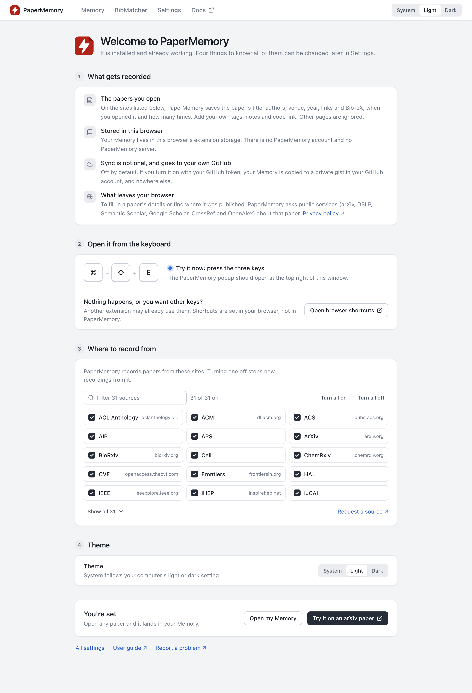
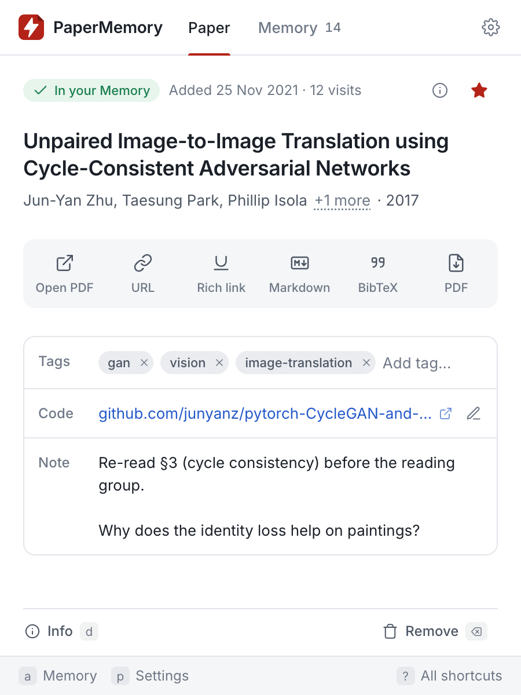
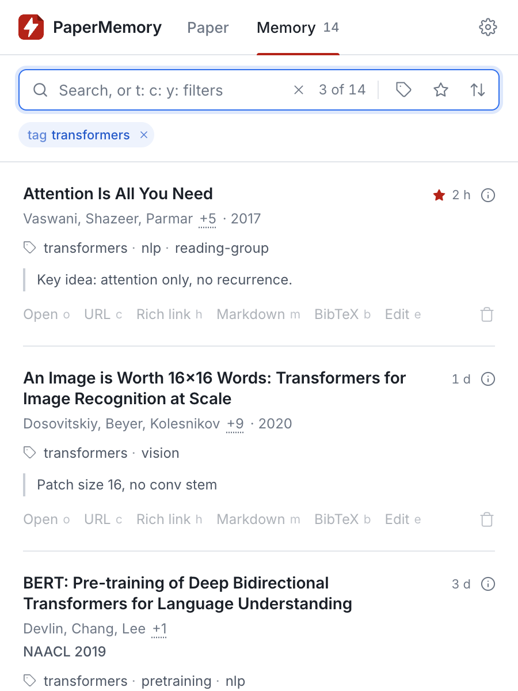
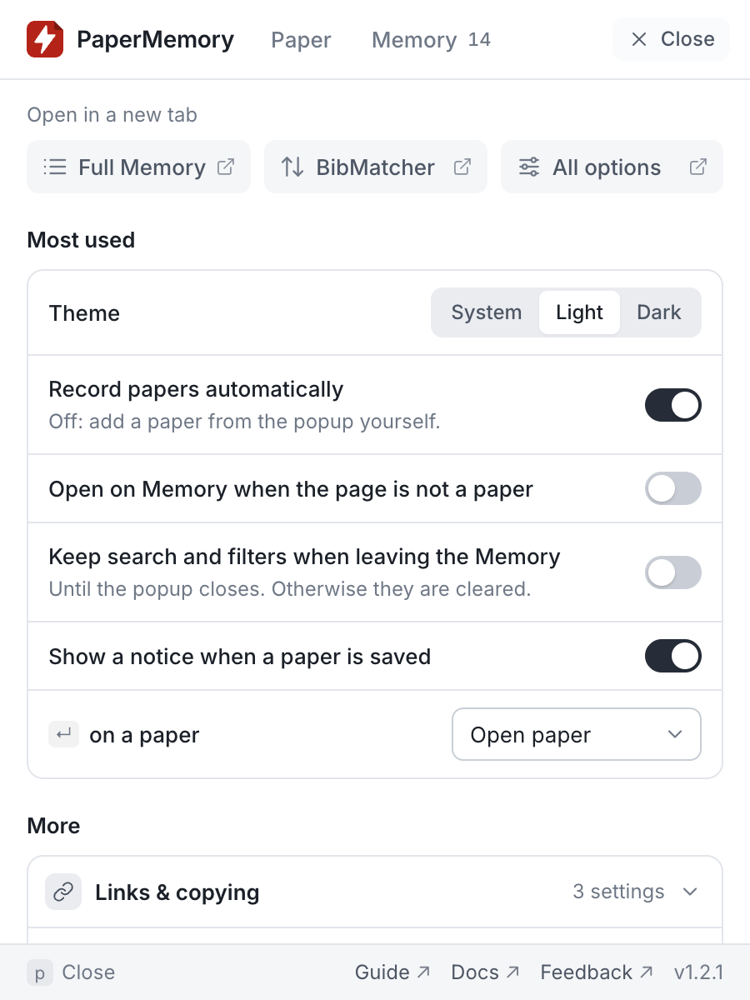
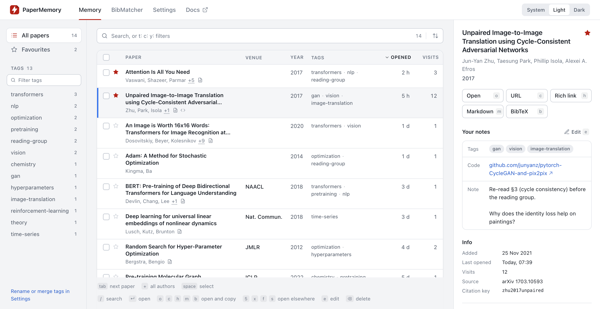
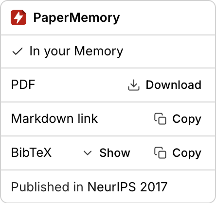
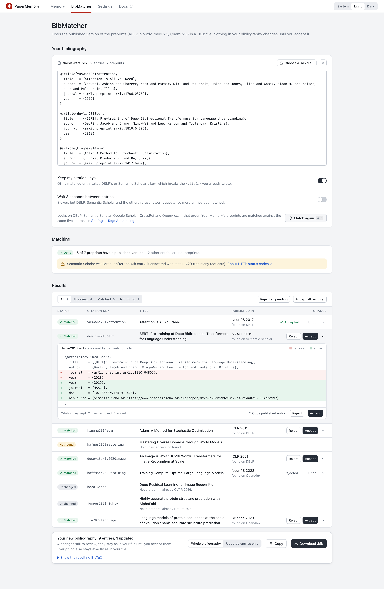
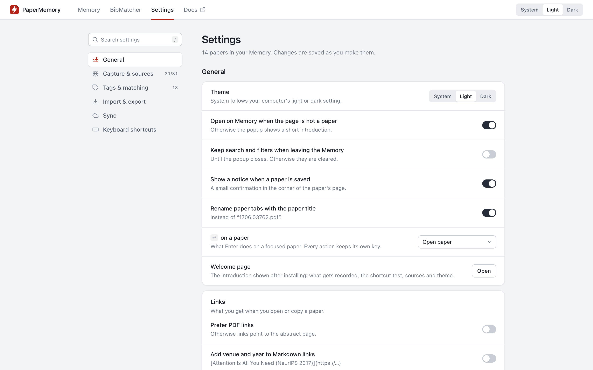

# Getting Started

## Installation

### Browser Stores

[:fontawesome-brands-chrome: Chrome / :simple-brave: Brave / :fontawesome-brands-edge: Edge](https://chromewebstore.google.com/detail/paper-memory/hmebhknlgddhfbbdhgplnillngljgmdi){ .md-button .md-button--primary }

 

  [:fontawesome-brands-firefox-browser: Firefox](https://addons.mozilla.org/en-US/firefox/addon/paper-memory/){ .md-button .md-button--primary }

### From source

PaperMemory is built with [WXT](https://wxt.dev/). You need [`npm`](https://docs.npmjs.com/downloading-and-installing-node-js-and-npm) (Node.js 22+ recommended).

=== "Chrome / Brave / Edge"

    * Clone the repository
    * Install dependencies with `npm install`
    * Build the extension with `npm run build:chrome`
    * Open the extension manager at `chrome://extensions/`
    * Turn on developer mode (top right)
    * Click "Load unpacked"
    * Select the `dist/chrome-mv3/` folder

=== "Firefox"

    * Clone the repository
    * Install dependencies with `npm install`
    * Build the extension with `npm run build:firefox`
    * Open `about:debugging#/runtime/this-firefox`
    * Click "Load Temporary Add-on"
    * Select the `manifest.json` file in the `dist/firefox-mv2/` folder
    * This install is temporary: load it again after you restart Firefox

For development commands (`npm run dev`, tests, packaging), see [`contributing.md`](https://github.com/vict0rsch/PaperMemory/blob/master/contributing.md).

!!! tip

    Pin PaperMemory to your browser's toolbar so its icon is always one click away.

## Welcome tab

{ align=right .advanced-screenshot }

The welcome tab opens once, when you install PaperMemory. It covers four things:

- What gets recorded, where your Memory is kept, and what leaves your browser.
- A test of the keyboard shortcut that opens the popup, with a link to your browser's shortcut settings if no shortcut is set.
- The Sources PaperMemory records papers from. Turn off the ones you do not want.
- The theme: System, Light or Dark.

You can open it again from the options page: General, then Welcome page.

## Popup

{ align=right .popup-display }

Click the PaperMemory icon in the toolbar, or use the keyboard shortcut (see [Keyboard shortcuts](configuration.md#keyboard-shortcuts)). The popup has two tabs.

**Paper** shows the paper of the current tab: title, authors, venue, the date it was added and its number of visits. From there you can:

- Open the PDF or abstract page, and copy the URL, a rich link, a Markdown link or the BibTeX.
- Download the PDF, or open the downloaded copy.
- Edit tags, the code link and a note. Changes are saved as you type.
- Mark the paper as a favourite, show its info, or remove it from your Memory.

If the paper is not in your Memory yet, click _Add it now_. On a page that is not a paper, the popup offers to open your Memory, and can add the page by hand (see [Adding any website](features.md#adding-any-website)).

{ align=left .popup-display }

**Memory** lists your saved papers. Press ++a++ to open it.

- Search titles, authors, notes, tags, IDs and venues as you type.
- Filter by tag (`t:`), year (`y:`) or code link (`c:`). Filters become pills and combine with free text. See [Searching](features.md#searching).
- Sort by last opened, last added, year, title or visits, and show favourites only.
- Each row can be opened, copied (URL, rich link, Markdown, BibTeX), edited, starred or deleted. Press ++"?"++ for their keys.

## Popup Settings

{ align=right .popup-display }

Click the :octicons-gear-16: button or press ++p++ to open popup Settings. It holds the settings you change most often: theme, automatic recording, what ++enter++ does on a paper, and links to the full-page Memory, BibMatcher and the options page.

Every setting is listed in [Configuration](configuration.md#popup-settings).

## Full-page Memory

{ align=left .advanced-screenshot }

Open it from popup Settings with _Full Memory_. Your Memory is shown in its own tab:

- A sortable table with venue, year, tags, last opened and visits.
- A tag list on the side, and a filter for favourites.
- A detail pane for the selected paper.
- Actions on several papers at once: add a tag, favourite, copy BibTeX, export a `.bib` file, delete.

Search and filters work as in the popup.

## PaperMemory block

{ align=right .popup-display }

On arXiv abstract pages, PaperMemory adds a small block next to the abstract. It shows whether the paper is in your Memory (with an _Add to Memory_ button if not), and can include:

- A PDF download button, or _Show in folder_ when the PDF is in your PaperMemoryStore.
- A Markdown link to copy.
- The BibTeX citation, to show or copy.
- The published venue and the code link, when known.

Choose which rows appear in popup Settings or on the options page (see [General](configuration.md#general)).

## BibMatcher

{ align=left .advanced-screenshot }

BibMatcher finds the published version of the preprints (arXiv, bioRxiv, medRxiv, ChemRxiv) in a `.bib` file. Open it from popup Settings.

- Paste your BibTeX, or drop or choose a `.bib` file.
- PaperMemory looks each preprint up on DBLP, Semantic Scholar, Google Scholar, CrossRef and OpenAlex.
- Each proposed change is shown as a diff. Accept or reject it, one by one or all at once.
- Turn on _Keep my citation keys_ so your `\cite{}` commands keep working.
- Copy or download the result. Entries you did not accept are left as they were.

BibMatcher never changes your Memory. See also [Preprint matching](features.md#preprint-matching).

## Options page

{ align=right .advanced-screenshot }

The options page holds every setting, in six groups: General, Capture & sources, Tags & matching, Import & export, Sync, and Keyboard shortcuts. A search field at the top filters the settings.

To open it, click _All options_ in popup Settings, or right-click the PaperMemory icon in the toolbar and choose _Options_.

Each group is described in [Configuration](configuration.md#options-page).

