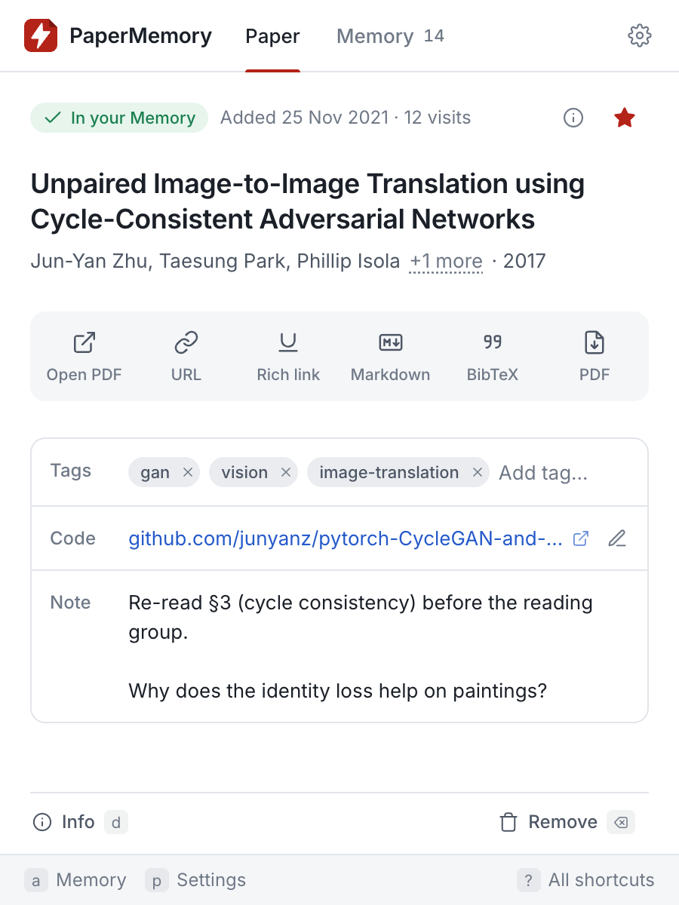
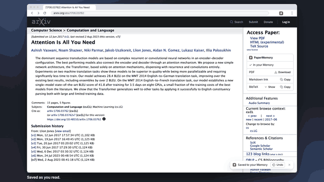
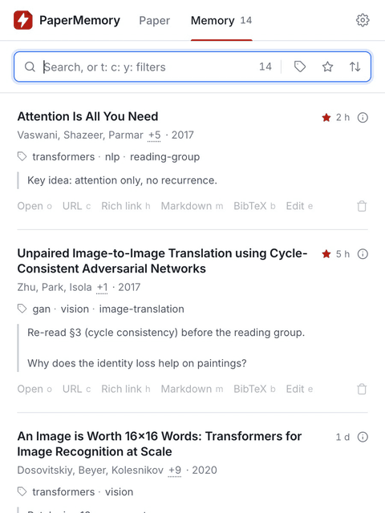
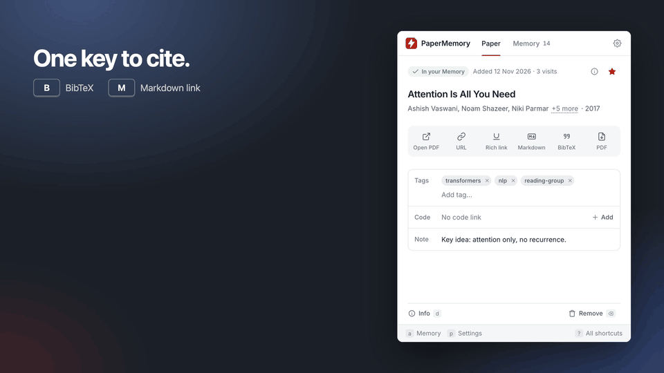
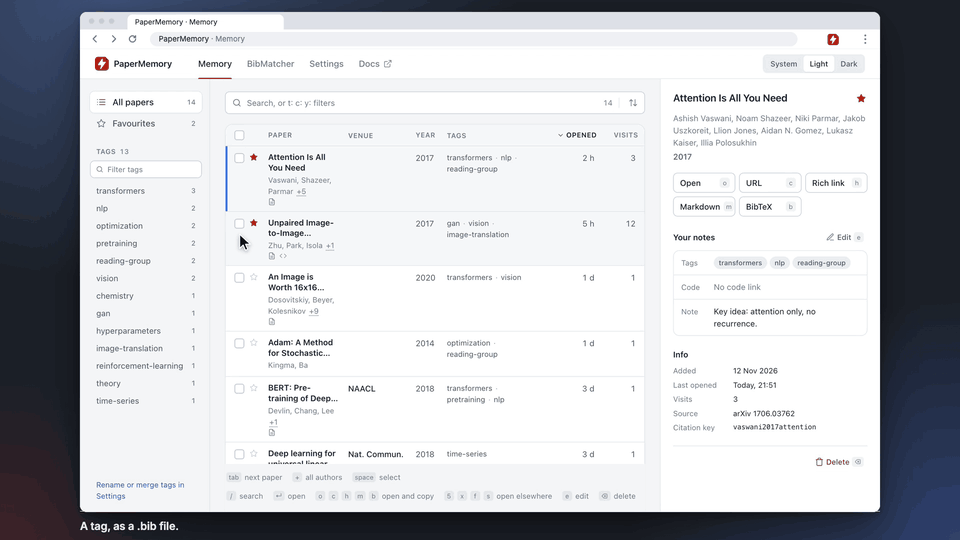
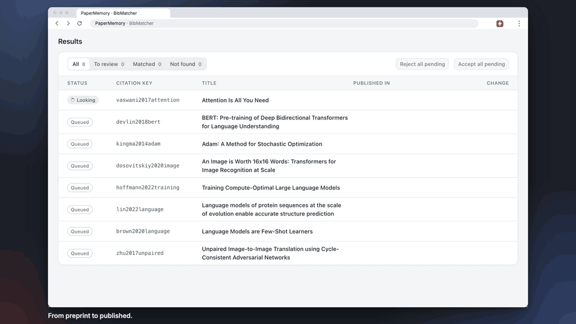

<h1 class="pm-hero__title">
    <strong class="pm-hero__brand">PaperMemory</strong> saves the research papers you open on arXiv, OpenReview and more. Search, tag, annotate and cite them from your browser.
</h1>
[Get the extension](getting-started.md#installation){ .md-button .md-button--primary }

 
Open a paper on a supported site and it is added to your Memory with its title, authors, venue, year, links and BibTeX. You can then search it, tag it, add a note and copy a citation, from the popup or from the full-page Memory.

## Recording

- Papers are saved when you open them on arXiv, OpenReview, NeurIPS, PMLR, ACL Anthology, CVF, Nature, Science, IEEE, ACM, Springer, bioRxiv, PubMed Central and 18 other publishers and archives. Abstract pages and PDFs both work.
- A small notice on the page confirms the save.
- Any other web page, such as a blog post or a documentation page, can be added from the popup.
- For preprints, PaperMemory looks for the published version on public bibliographic services (DBLP, Semantic Scholar, CrossRef, OpenAlex and Google Scholar) and shows the venue when it finds one.

[Saving papers](features.md#saving-papers) · [Preprint matching](features.md#preprint-matching)

<figure markdown>

<figcaption>Saved as you read.</figcaption>
</figure>

## Finding papers

- Search titles, authors, notes, tags, IDs and venues as you type.
- Filter by tag (`t:`), year (`y:`) or code link (`c:`). Filters appear as pills and combine with free text.
- Tags, a note, a code link and a favourite star on every paper.
- Sort by date added, last opened, title, year or number of visits.
- A full-page Memory with a table view, a tag list and actions on several papers at once (tag, favourite, copy BibTeX, export, delete).

[Searching](features.md#searching) · [Full-page Memory](getting-started.md#full-page-memory)

<figure markdown>

<figcaption>Filter by tag and year, then search the rest.</figcaption>
</figure>

## Citing and sharing

- Copy a paper's BibTeX, Markdown link, rich link or URL with one click or one key.
- Export your Memory, or the papers with a given tag, as a `.bib` file.
- BibMatcher: give it a `.bib` file and it proposes the published version of each preprint (arXiv, bioRxiv, medRxiv, ChemRxiv). You accept or reject every change, and your citation keys can be kept.

[BibTeX export](features.md#bibtex-export) · [BibMatcher](getting-started.md#bibmatcher)

<figure markdown>

<figcaption>One key for BibTeX, one for a Markdown link.</figcaption>
</figure>

<figure markdown>

<figcaption>A tag, as a .bib file.</figcaption>
</figure>

<figure markdown>

<figcaption>From preprint to published.</figcaption>
</figure>

## On paper pages

- On arXiv, a small PaperMemory block shows whether the paper is saved, with BibTeX, a Markdown link, a PDF download and the published venue.
- PDF tabs are renamed with the paper's title instead of a file name such as `1706.03762.pdf`.
- PDFs can be downloaded with a readable name into a PaperMemoryStore folder in your Downloads; on arXiv, the block then shows the file in its folder.
- Open an arXiv paper on ar5iv, alphaXiv, Hugging Face or SciRate.

[PaperMemory block](getting-started.md#papermemory-block) · [PaperMemoryStore](features.md#papermemorystore)

## Your data

- Your Memory is stored in your browser's extension storage. There is no PaperMemory account and no PaperMemory server.
- No analytics, no tracking.
- Optional Gist sync copies your Memory to a private Gist in your own GitHub account. Off by default.

[Privacy](features.md#privacy) · [Gist sync](features.md#gist-sync) · [All features](features.md)

<a href="privacy-policy/">Privacy Policy</a>

