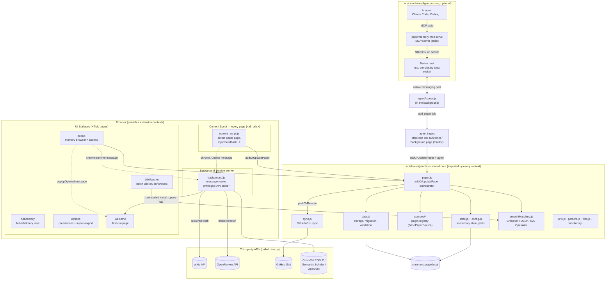
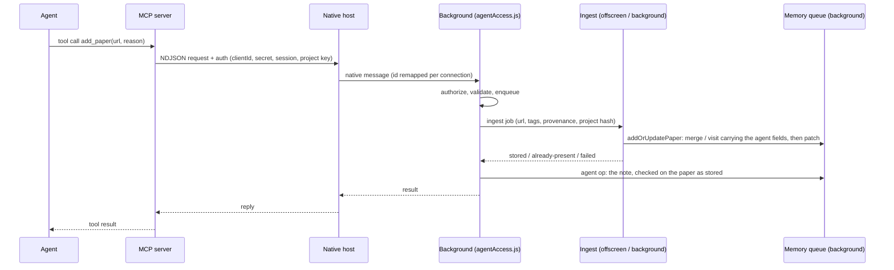

# PaperMemory — System Architecture

> Source of truth for the repository's architecture. Read this before broad
> grepping. Keep it current when components, boundaries, data flow, key
> abstractions, or integrations change (see `.claude/rules/keep-system-architecture-up-to-date.md`).
>
> **This doc covers how the system works** — mental model, data flow,
> abstractions, design rationale, invariants. For how to set up, build, and
> contribute (commands, conventions, step-by-step how-tos, tests, release), see
> [`contributing.md`](contributing.md).

## Overview

**PaperMemory** is a cross-browser (Chrome/Brave/Edge + Firefox) WebExtension that
acts as an automated, minimalist reference manager for research papers. As the user
browses, it silently detects when a tab is a known paper page (arXiv, OpenReview,
NeurIPS, Nature, IEEE, and ~30 other academic sources), parses the paper's metadata,
and records it in a local library ("the Memory"). On top of recording, it enriches
papers: it discovers code repositories, matches preprints to their published
versions across several bibliographic databases, generates BibTeX and Markdown
links, rewrites PDF tab titles to human-readable names, and can sync the whole
library to a private GitHub Gist.

The system is a **client-side-only** application: there is no backend owned by the
project. All persistence is in `chrome.storage.local`; all enrichment happens by
calling third-party public APIs directly from the extension. The "server" role is
played entirely by the **background** (a service worker in the Chrome MV3 build, a
background page in the Firefox MV2 build), which writes the Memory and brokers
cross-origin fetches and privileged browser APIs on behalf of UI surfaces and
content scripts.

The target reader of this document is an engineer who needs to reason about how a
URL becomes a stored, enriched paper — and how to add a new paper source or UI
surface without breaking the (deliberately load-order-sensitive) module graph.

## System Architecture

PaperMemory is built with **[WXT](https://wxt.dev/)** (`wxt.config.js`), which
compiles the `src/` tree into a Manifest V3 extension for Chrome and a Manifest V2 one for
Firefox. WXT's role is purely
build-time: it wires `src/entrypoints/*` into manifest-declared contexts (background
worker, content script, and five HTML pages), applies the `@pm` / `@pmu` path
aliases, and produces per-browser bundles. There is no runtime framework — the code
is plain ES modules (plus jQuery for the content script's injected page UI).

### Communication patterns

- **Shared-core imports.** The bulk of logic lives in `src/shared/js/utils/` and is
  imported directly into whichever context needs it (popup, content script, worker).
  There is one logical codebase executed in several JS realms; `state`/`config.js`
  is a per-realm singleton, **not** shared memory across contexts.
- **Message passing (`chrome.runtime`).** Used for two things: (1) the content
  script and popup ask the background worker to perform privileged or
  cross-origin operations they cannot do themselves; (2) the worker pushes
  commands (keyboard shortcuts, tab-URL changes) into content scripts; (3) the popup
  announces itself (`{ type: "popupOpened" }`, fire-and-forget, `lastError` read so no
  listener is fine) for the welcome page's shortcut test — the background ignores it. The router is
  the single `chrome.runtime.onMessage` listener in `background.js` (a `type`-keyed
  `if/else` chain). It rejects messages whose `sender.id !== chrome.runtime.id`.
- **Storage as the integration bus.** All contexts read the same
  `chrome.storage.local` `papers` object, but only the background writes it: pages and
  content scripts send it operations (`memoryOp`, `{ type: "memory" }`,
  [`memoryQueue.js`](src/shared/js/utils/memoryQueue.js)), which it applies one at a time
  to the Memory as stored now. `ignoreSources` follows the same pattern
  (`{ type: "ignoreSources" }`, `ignoreSources.js`). See _Concurrency_ below.

### Agent access (optional, off by default)

Lets local AI agents search the Library and add papers. Terms (Library, Project,
Provenance, Own addition...) are defined in [`CONTEXT.md`](CONTEXT.md); the decision
and its trade-offs in [ADR 0002](docs/adr/0002-native-messaging-hub-for-agent-access.md).
User docs: [`docs/agents.md`](docs/agents.md). The extension side is the only part
that can be woken by the browser, so the chain is:

Agent → **MCP server** (`papermemory-mcp serve`, stdio, one process per Agent session)
→ per-Library **Unix socket** (`~/.papermemory/sock/<libraryId>.sock`, NDJSON) →
**Native host** (launched by the browser, forwards only) → `runtime.connectNative`
port → `agentAccess.js` in the background → operation handlers.

- **`agent/` package** (`papermemory-mcp`, published to npm; excluded from the
  extension zip): `cli.mjs` (`install`, `uninstall`, `selfheal`, `libraries`,
  `serve`), `host/host.mjs` (native host hub), `src/serve.mjs` (MCP server, resolves
  the Project folder and derives the Project key; pairs on the first authenticated call
  or `connect`: the call answers `pairing-required` after ~2 s while the `pair` request
  stays open until the user decides, and later calls wait for it), `src/libraries.mjs` (socket
  discovery, version negotiation, requests), `src/install.mjs` + `browsers.mjs` +
  `agents.mjs` (the installer: local copy in `~/.papermemory/bin` with wrappers, native
  host manifests, agent registration, skill copy), `skills/<name>/SKILL.md` (the
  `papermemory` skill for everyday use and the `papermemory-setup` skill for setup and
  troubleshooting, both copied to `~/.agents/skills/` and `~/.claude/skills/`). macOS
  only.
- **`src/background/agentAccess.js`** (initialised from `background.js` with the
  injected `pushSyncPapers` and the message handler): connects the native port,
  authorizes every op (per-client secret hash, rate limit, bounded queue), runs one
  serialized mutation queue with per-job deadlines, handles pairing (a prompt tab whose
  window it brings to the front, and an OS notification when `notifications` is granted)
  and the storage proxy, and re-connects from a 1-minute `alarms` alarm. Its changes to papers are
  `agent` operations of the Memory's queue (`memoryQueue.js`, see _Concurrency_).
- **`src/shared/js/utils/agentOps.js`**: pure operations (argument validation and
  bounds, tag rules, search, Project papers, BibTeX export, Provenance, ownership,
  rate check), no `chrome.*`, unit-tested in `test/test-agent-ops.js`.
- **Ingest** (`src/background/agentIngest.js`): an agent-added paper runs the normal
  `addOrUpdatePaper` pipeline with its new `agent` parameter. Chrome's service worker
  has no `DOMParser`, so it runs in the **offscreen document**
  (`src/entrypoints/agentIngest/`, reason `DOM_PARSER`), which has only
  `chrome.runtime`: its Memory writes are queue operations sent to the background like
  a page's (`memoryOp`, `{ type: "memory" }`), and its `chrome.storage` is a **storage
  proxy** to the background (hidden keys, only `urlHashToId` writable, only while the
  document exists); since it lacks `getManifest` it reads the packaged `manifest.json`
  before `initState`. On Firefox (MV2 background page with a DOM) it runs directly
  in the background. A `url` that is a DOI (a doi.org URL, `doi:…` or a bare `10.…`:
  `urlToDoi` in `urls.js`) is first resolved to the page it is registered to
  (`resolveDoi`: the DOI Handle API, `doi.org/api/handles/<doi>?type=URL`, 5 s, http(s)
  only), which is then added as if the agent had given it; the paper keeps the DOI when
  its page gives none (`addOrUpdatePaper`'s `doi`). A DOI that cannot be resolved answers
  `unsupported-url` with a `message`; one registered to a page no Source supports,
  `unsupported-url` with that `resolvedUrl`.
- **Options page** ([`src/options/agentAccessUI.js`](src/options/agentAccessUI.js)):
  its "Agent access" section (between Sync and Keyboard shortcuts) holds the Agent
  access toggle (requests the optional `nativeMessaging` and `notifications` permissions
  in the click's gesture), connection status and the **Paired clients** list with Revoke; the pairing
  prompt (Allow / Deny, accepted only from the options tab the background opened for
  it) is a card above the settings.

Agent writes are Memory operations followed by a Gist push (`pushSyncPapers`: uploads
run one at a time, those asked for meanwhile share the next one), so sync stays
last-writer-wins.

### Why the background worker brokers fetches

Several source parsers (`arxiv.js` via `fetch-arxiv-xml`, `openreview` via
`OpenReview*JSON`) and all preprint-matching calls are routed through the worker
even though `fetch` exists in content scripts. The worker holds `host_permissions:
["*://*/*"]`, so it can issue cross-origin requests without being subject to the
visited page's CSP or CORS posture. Content scripts delegate via
`sendMessageToBackground({ type: ... })`.

## Core Concepts & Abstractions

### Paper sources — the plugin registry

The defining abstraction is the **paper source**: a class extending
`BasePaperSource` ([`sources/base.js`](src/shared/js/utils/sources/base.js)) that
knows how to recognise and parse one family of URLs. Sources are **stateless** —
the class is never instantiated; only static members are used, and papers stay
plain objects. Each source declares:

- `name` — internal key, matches `paper.source` and the `is.{name}` flag.
- `displayName`, `isPreprint`, and `patterns` (`"host/path"` strings, matched on
  the parsed URL's host or a subdomain and a path prefix, or `(url) => boolean`
  predicates that anchor on the host with `isOnHost` from `base.js`). Wrapper
  URLs (proxy or PDF-viewer URLs embedding an `http(s)://` paper URL in their
  path, in any query parameter of an extension page, or in the `url` / `qurl`
  parameter of an EZproxy `/login` page) are unwrapped with `unwrapUrl`
  (`sources/index.js`) at the entry points (`isPaper`, `parseIdFromUrl`,
  `makePaper`, `addOrUpdatePaper`) before matching, so patterns only ever see the
  paper URL.
- `matches(url)`, `urlToId(url, ctx)`, `parse(url, tab, ctx)`, plus URL
  transforms `toAbs` / `toPDF` and venue helpers.

All ~32 concrete sources are registered **once** in
[`sources/index.js`](src/shared/js/utils/sources/index.js)'s `ALL_SOURCES` array.
From that single list the module derives every lookup the rest of the code needs:
`getSource(name)`, `knownPaperPages` (consumed by `isPaper`), `sourceFromIs`,
`matchUrl`, `preprintSources`, and `SOURCE_DISPATCH_ORDER`. **Adding a source = create
the module + add one import/array entry.** Patterns must be mutually exclusive — this
is enforced by the "Source Pattern Mutual Exclusion" test in `test/test-meta.js`.
For the step-by-step procedure, see
[`contributing.md` → Adding a paper source](contributing.md#adding-a-paper-source).

`WebsiteSource` is special: it is the universal fallback for arbitrary pages and is
**excluded** from `DISPATCH_SOURCES`. It is invoked explicitly in `paper.js`
(`getSource("website")`) when the user manually parses a non-academic page, never via
pattern dispatch.

> **Load-order constraint (documented in `base.js`):** `functions.js` imports
> `getSource` from `sources/index.js`, which imports every concrete source — some of
> which import back from `functions.js`. This cycle is safe **only** because source
> modules consume `functions.js` bindings inside method bodies (runtime), never at
> module top level. Evaluating a `functions.js` export inside a static initialiser
> (e.g. `static patterns = [...]`) hits a Temporal Dead Zone and crashes the
> extension at load.

### The "is" map and source dispatch

[`isPaper(url)`](src/shared/js/utils/paper.js) returns an object `is` mapping every
source name → boolean (plus `localFile`, `stored`, `parsedWebsite`). This map is the
currency of dispatch: `sourceFromIs(is)` walks `DISPATCH_SOURCES` and returns the
first source whose flag is set, while `parseIdFromUrl` walks `SOURCE_DISPATCH_ORDER`
to resolve a stable id. Because patterns are mutually exclusive, dispatch order is
not semantically meaningful.

### Stable IDs and de-duplication

A paper's identity is its `id` (e.g. `Arxiv-2103.12345`, `Website_<hash>`). Two
fuzzy de-dup mechanisms keep the library clean:

- **`urlHashToId`** — `miniHash(url) → id`, a fast cache so a revisited URL
  resolves without re-parsing. `addOrUpdatePaper` also records the visited URL on
  capture when it does not already resolve to the stored id (e.g. sources whose
  URLs carry no id). Keys are the full normalised URL (`miniHash` lowercases and
  strips non-word characters; it is not a hash).
- **`titleHashToIds`** — `miniHash(title) → [ids]`, used by `findFuzzyPaperMatch` to
  detect that a freshly parsed paper is the same work as an existing one under a
  different source (e.g. an arXiv preprint and its NeurIPS published version).
  `preprintSources` is consulted so a non-preprint match is preferred as the
  canonical record.

## Data Models

### The `paper` object

The single domain entity. It is a plain object validated (and defaulted) by
[`validatePaper`](src/shared/js/utils/data.js) against a schema of expected keys:

| Field                              | Type          | Notes                                                 |
| ---------------------------------- | ------------- | ----------------------------------------------------- |
| `id`                               | string        | Unique PaperMemory id; primary key in `papers`        |
| `source`                           | string        | A registered source `name`                            |
| `title`, `author`, `year`, `venue` | string        | Core metadata (`author` is `and`-separated)           |
| `bibtex`, `key`, `doi`             | string        | Citation data; `key` is the BibTeX key                |
| `pdfLink`, `md`                    | string        | PDF URL and a pre-rendered Markdown link              |
| `codeLink`, `code`                 | string/object | Repo URL + legacy PapersWithCode payload (old papers) |
| `note`                             | string        | Free-text + auto-generated "Accepted @ …" venue notes |
| `tags`                             | string[]      | User + auto-tags (`autoTagPaper`)                     |
| `favorite`, `favoriteDate`         | bool/string   | Starring                                              |
| `count`, `addDate`, `lastOpenDate` | number/string | Visit tracking + sort keys                            |
| `extras`                           | object        | Optional per-source overflow                          |
| `provenance`                       | object        | Optional, Agent access: which client added the paper, why, when (hashes only, never the keys); removed once the user opens or edits the paper (a page's `visit`, `merge`, `patch` or `addTags`; not the pipeline's enrichment `patch`, an agent's own writes or a `retag`) |
| `projectHashes`                    | string[]      | Optional, Agent access: hashes of the Projects the paper belongs to |

### Storage layout (`chrome.storage.local`)

The `papers` key holds an `{ id → paper }` map plus a `__dataVersion` sentinel.
Other top-level keys: `prefs`/menu checks, `autoTags`, `ignoreSources`,
`urlHashToId`, sync state, and periodic backups. Agent access adds `agentAccess`
(`{enabled}`), `agentLibrary` (`{libraryId}`), `agentClients` (paired clients: name,
secret hash, timestamps), `agentProjects` (`{[projectHash]: {label, tag, createdAt}}`)
and `agentReopenOptions`; the pure operations live in `agentOps.js`. `unlimitedStorage` is requested so
the library can grow without quota errors.

### Migration

[`migrateData`](src/shared/js/utils/data.js) runs on every `initState`. It compares
the stored `__dataVersion` against a hardcoded `latestDataVersion` and applies an
ordered chain of `if (currentVersion < N)` blocks that mutate papers in place
(backfilling defaults, renaming sources, fixing links), recording a per-paper
`migrationSummaries` audit trail. A backup is taken before migrating.

### In-memory state

`config.js` exports a per-realm `state` singleton (current papers, sorted lists,
tags, prefs, the title-rendering function, hash caches, UI flags). `state.js`
`initState` is the canonical hydrator: load papers → backup → migrate → load prefs &
caches → (UI contexts only) match local files, sort, build tag set. It is invoked in
the worker, popup, content script, and full-memory page.

## Component Deep-Dive

### `paper.js` — the parse/enrich/store orchestrator

**Location:** [`src/shared/js/utils/paper.js`](src/shared/js/utils/paper.js)
The heart of the system. `addOrUpdatePaper({url, is, prefs, tab, ...})` is the single
funnel through which papers enter the Memory. Its pipeline: resolve id
(`parseIdFromUrl`) → update-visit-or-`makePaper` → fuzzy-dedup merge
(`mergePapers`) → save through the
background queue (`memoryOp`: `visit` / `merge`) → `pushToRemote` → asynchronous preprint
matching (`tryPreprintMatch`) to backfill venue/bibtex → second save (`patch`). An optional `agent` parameter (`{tags, provenance, projectHash}`, Agent access) goes with the
first save's operation: the queue adds the agent's tags and Project membership to the paper
as stored, and Provenance only when that `merge` creates it; the `patch` writes publication
fields only (marked `enrichment`: it keeps the agent's Provenance). A paper already stored (its id, a URL resolving to it, or a fuzzy match) is only
attached: a `visit` carrying the agent fields, with no merge, promotion, URL remapping or
`patch` (the queue attaches the same way when the agent's `merge` finds the paper stored
meanwhile). It also returns `isNew` (the save's answer) and `done` (after the last write,
also when processing fails).
Caller-supplied `contentScriptCallbacks`
(`update`/`preprints`/`done`/`feedback`) let the content script render progressive
feedback. `makePaper` dispatches to `src.parse()` and stamps `paper.source`.

### `sources/*` — source plugins

**Location:** [`src/shared/js/utils/sources/`](src/shared/js/utils/sources/)
~32 `BasePaperSource` subclasses + the `index.js` registry + `WebsiteSource`
fallback. See _Core Concepts_. Source-specific scraping helpers were factored out of
`functions.js` into per-source modules (recent refactor, commits `1b18d72`/`ebf02e1`).

### `background.js` — service worker

**Location:** [`src/background/background.js`](src/background/background.js)
(entrypoint wrapper at `src/entrypoints/background.js`). Hosts the message router,
brokered fetches (arXiv XML, OpenReview notes/forums, Google Scholar, the
preprint-matching APIs), the toolbar badge state machine
(`badgeOk/Wait/Error/Clear`), keyboard-command handlers (`manualParsing`,
`downloadPdf`, `defaultAction`), the PDF-title rewriter (`chrome.tabs.onUpdated` +
`chrome.scripting.executeScript`), Gist push/pull, and the single writer queues: the Memory
(`runMemoryOp`, `memoryQueue.js`) and `ignoreSources` (`applyIgnoreSources`,
`ignoreSources.js`, patches from the sources pickers). On popup disconnect it pushes
sync. `runtime.onInstalled` (`openWelcomeOnInstall`, `src/background/welcome.js`) opens the
welcome page in a tab when `reason === "install"` only (never on an update of the extension or
the browser). It also hosts `initAgentAccess` (see _Agent access_).

### `content_script.js` — page integration

**Location:** [`src/content_scripts/content_script.js`](src/content_scripts/content_script.js)
Injected at `document_start` on `<all_urls>`. On load it runs `initSyncAndState`,
pings the worker (`hello`), then calls `isPaper(url)`; on a hit it invokes
`addOrUpdatePaper` and shows notices (bottom right: "Reading this paper…", "Saved to your
Memory" + Undo, copied, "Couldn’t save this paper" + Try again). Also listens for
worker-pushed commands and provides in-page actions (copy BibTeX/MD link, open
abstract/PDF/ar5iv/HuggingFace, etc., shared with the popup's `handlers.js`).
On arXiv abstract pages it adds one block at the end of arXiv's right column (status,
Add to Memory, PDF, Markdown link, BibTeX, venue, Code), never resizing arXiv's columns.
The block and the notices/tooltips each live in a **shadow root** styled by
`content_ui.css` (+ `public/tokens.css` scoped to the notices' root, which carries
`data-theme`), so page CSS and ours never mix; the block takes its colours from the page's
text colour, the notices follow `prefs.theme`. Bundled Inter is loaded from the extension
(`fonts/*.woff2`, web-accessible) as "PaperMemory Inter". Its writes (save, Undo, Add to
Memory, Try again) are Memory operations sent to the background (`memoryOp`); one run at a
time drives the block (callbacks of an older run are ignored). Whether the paper's PDF is
downloaded, and showing it in its folder, is asked of the background (`{type: "stored-pdf",
id, show?}` → `{found}`), which owns the `downloads` API. Its Download asks the background
too (`download-pdf-to-store`, `store` = PaperMemoryStore/ or the downloads folder), which
starts it and answers `{id, ok}` at once, remembers download id → tab id
(`storage.session` `pdfDownloadTabs`, in memory where there is no session storage), and on
`complete` / `interrupted` / erased (one top-level `downloads.onChanged` / `onErased`
listener) sends the tab `{message: "pdfDownloadDone", id, ok}` and forgets it; the row then
reads "Show in folder".
The manifest-injected `content_script.css` only styles the venue badge of ar5iv /
HuggingFace pages.

### UI surfaces — `popup`, `fullMemory`, `options`, `bibMatcher`, `welcome`

**Location:** `src/popup/`, `src/fullMemory/`, `src/options/`, `src/bibMatcher/`, `src/welcome/`
(thin `src/entrypoints/*/main.js` wrappers import the real logic + `debug.js`).

- **popup** ([`popup/js/popup.js`](src/popup/js/popup.js), `memory.js`, `handlers.js`,
  `templates.js`, `tagfield.js`) — primary surface: the Memory list (search with
  combinable `t:`/`c:`/`y:` filter pills, tag list, sort menu, in-row edit form), per-paper
  actions, the preferences menu, and on-open parsing of the active tab. `tagfield.js` is
  the tag input shared by the paper view and the row edit form (suggestions with counts,
  near-duplicate hint). HTML is
  assembled from `popup/html/**` fragments via a custom `<!--=include -->` Vite
  plugin (`htmlIncludePlugin` in `wxt.config.js`).
- **fullMemory** ([`fullMemory/fullMemory.js`](src/fullMemory/fullMemory.js)) — the Memory
  in a tab: tag sidebar, sortable table, detail pane (a drawer from 900 to 1200px), bulk
  select; below 900px the popup's rows. It reuses the popup's search, rows, edit form and
  handlers (`memory.js` renders its table through `setListRenderer`). Writes go through the
  background queue (bulk actions as one `batch`; bulk "Add tag" uses the `addTags`
  operation, which reads the stored tags). Views follow `chrome.storage` changes
  (`onPapersChange`), held while an edit form, a dialog or a bulk action is in progress;
  no periodic reload. Sync status comes from `sync.js` as a `pm-sync-status` DOM event.
- **options** — preferences, custom PDF-title function, auto-tag rules, JSON/BibTeX
  import & export (the import from URLs also takes DOIs, resolved to their pages as for an
  agent's add), sync configuration. The sources picker (`ignoreSources`) is shared with the
  welcome page: `src/shared/js/sourcePicker.js` + `src/shared/html/source-picker.html`. Its
  changes are `{source: bool}` patches applied by the background, and every open picker
  re-renders on `ignoreSources` storage changes.
- **welcome** ([`welcome/welcome.js`](src/welcome/welcome.js)) — first-run page, opened by the
  background on install and from Settings > General > Welcome page: what gets recorded
  (static), a shortcut test (key caps from `chrome.commands.getAll()` `_execute_action`;
  waiting → "It works" on the popup's `popupOpened` message; "No shortcut set" when empty; Open
  browser shortcuts via `shortcuts.js` `openShortcutSettings`), the shared sources picker, and
  the theme switch (`[data-set-theme]`, wired by the top bar, writes `prefs.theme`). It
  writes nothing else.
- **bibMatcher** — a standalone tool: paste, choose or drop a `.bib` file; each preprint
  entry (any field mentioning `rxiv`: arXiv, bioRxiv, medRxiv, ChemRxiv) is looked up on
  DBLP → Semantic Scholar → Google Scholar → CrossRef → OpenAlex (`preprintMatching.js`,
  whose `isPreprintRecord` refuses a preprint's own record as its published version). Each
  proposed change is shown as a BibTeX diff to accept or reject; Copy / Download (Blob)
  replace only the accepted entries in the text as given (everything else, comments and
  `@string` included, byte for byte), after a warning dialog when some are not reviewed. It
  never writes the Memory or the prefs.

### `sync.js` — GitHub Gist synchronisation

**Location:** [`src/shared/js/utils/sync.js`](src/shared/js/utils/sync.js)
Optional cross-device sync via a private GitHub Gist using a user-supplied Personal
Access Token (`@octokit/request`). `getIdentifier` stamps writes with a per-device
`__syncId` so a device ignores its own echoes on pull: the background answers
`{ sameDevice: true }` and the page applies nothing (writing its Memory back would undo
what changed since it was read). `pushToRemote` is fired
after every storage write; pull/merge happens on init and popup connect.

### Supporting utilities

`data.js` (storage/migration/validation/prefs), `urls.js` (id resolution, and a DOI's
registered URL for adds without a tab),
`parsers.js` (DOM/JSON/BibTeX fetch helpers + DC meta-tag extraction),
`bibtexParser.js`, `files.js` (matching downloaded PDFs in `PaperMemoryStore/` via
the `downloads` API), `functions.js` (49 misc helpers incl. `miniHash`,
`sendMessageToBackground`), `miniquery.js` (a tiny jQuery-ish DOM helper).

## Key Workflow — automatic capture of a paper

1. User opens e.g. `https://arxiv.org/abs/2103.12345`.
2. WXT-injected **content script** runs `initSyncAndState`, pings the worker,
   computes `is = isPaper(url)`.
3. `is.arxiv` is true → `addOrUpdatePaper({url, is, prefs})`.
4. `parseIdFromUrl` → `ArxivSource.urlToId` → `Arxiv-2103.12345` (de-dup against
   `titleHashToIds` for an existing published version).
5. New id → `makePaper` → `ArxivSource.parse`, which asks the **worker** to fetch
   `export.arxiv.org/api/query` (`fetch-arxiv-xml`), parses the Atom XML into a
   `paper`, builds a BibTeX entry.
6. `initPaper` defaults fields, runs `autoTagPaper`, `validatePaper`.
7. The background saves it (`memoryOp`) → `pushToRemote`.
8. Async `tryPreprintMatch` queries CrossRef/DBLP/S2/OpenAlex to backfill the
   published venue/bibtex; a second save (`patch` operation) persists it.
9. Content-script callbacks show the "Saved to your Memory" notice (Undo = a `delete`
   operation) or, when parsing or the write failed, "Couldn’t save this paper" with Try
   again; the worker may rewrite the PDF tab title.

## Concurrency & Invariants

- **Concurrent writers.** Multiple tabs can parse or edit the same paper simultaneously.
  The Memory has one writer, the background: every change is an operation (`patch`,
  `visit`, `merge`, `retag`, `batch`, …) applied in one queue to the Memory as stored now
  (`runMemoryOp`), never a snapshot written back; a whole-Memory `replace` can be refused
  when `papersRevision` changed since it was prepared. Treat `state.papers` as a stale
  snapshot, never the source of truth at write time. `ignoreSources` is written the same
  way (`applyIgnoreSources`). `updateDuplicatedUrls` (not queued) re-reads
  `urlHashToId` before applying its change and writing the map back.
- **Agent writes** run one job at a time in `agentAccess.js`; before each job it re-checks
  that Agent access is on and the client still authorized. Each change to papers is one
  `agent` operation of the Memory's queue (background only: it carries a function), which
  checks the arguments, the note length and, for a deletion, ownership on the papers as
  stored, in the same step that changes them, and refuses the change if the client was
  revoked or Agent access turned off since the job started. The `{ type: "memory" }`
  message route refuses `agent` operations and inline Memories, also inside a `batch`. An
  add's writes are the pipeline's `merge` / `visit` (carrying the agent fields) and `patch`;
  for a paper already stored, only that first write, which attaches it. A page's `visit`,
  `merge`, `patch` or `addTags` (the user opening or editing a paper) removes the paper's
  Provenance; the enrichment `patch`, the agent's own operations and `retag` keep it.
- **Pattern mutual exclusion** across sources is a hard invariant (test-enforced).
- **No top-level use of `functions.js` exports inside source modules** (TDZ — see
  the `base.js` constraint above).
- **`state` is per-realm.** Do not assume the popup's `state` reflects the content
  script's; reconcile through storage.

## Technical Stack

- **Build:** WXT 0.21 (Vite under the hood), Manifest V3 for Chrome and Manifest V2 for Firefox; a `build:manifestGenerated` hook renames `_execute_action` to `_execute_browser_action` for MV2.
- **Runtime libs:** jQuery 4 (content script: arXiv API title lookup for downloads), `@octokit/request` (Gist).
- **Language:** plain ES modules (`"type": "module"`), JSDoc-typed, no TypeScript;
  `jsconfig.json` + `@pm`/`@pmu` path aliases.
- **Tooling:** Prettier; Mocha + jsdom + [cloakbrowser](https://github.com/CloakHQ/cloakbrowser)
  (source-level stealth Chromium, Puppeteer-core API) for the `test/test-*.js`
  suite (unit + headless-browser integration). `npm test` builds Chrome first
  (`pretest`) then runs Mocha. The cloakbrowser binary (~200MB) auto-downloads
  to `~/.cloakbrowser` on first use; CI caches it via `actions/cache`.
- **External APIs (no project backend):** arXiv, OpenReview, GitHub Gist, CrossRef,
  DBLP, Semantic Scholar, OpenAlex, Google Scholar, the DOI Handle API (doi.org).
- **Permissions:** `activeTab`, `storage`, `unlimitedStorage`, `downloads`(+`.open`),
  `scripting`, `alarms`, `offscreen` (Chrome build only), optional `nativeMessaging` and
  `notifications` (requested together when Agent access is turned on; granted at install only in
  `WXT_PM_AGENT_TEST=1` test builds, set in the environment or a `.env` file, which
  `wxt zip` refuses), and `host_permissions: *://*/*`.
- **Docs site:** MkDocs Material (`mkdocs.yml`, `docs/`) published to papermemory.org. Site and Readme screenshots and web videos (walkthrough + feature loops) are generated from the real build with `node scripts/store-assets/build.mjs docs` (writes `docs/assets/`).

## Key Design Decisions

- **Stateless source classes over instances (Option A, per `base.js`).** Saved
  papers are plain objects (JSON in `chrome.storage`, runtime messages, and Gist
  sync), and the background (an MV3 service worker in Chrome) terminates frequently — so there is no long-lived
  "paper with methods" to hydrate, and prototype identity would be lost across
  every storage/message boundary anyway. Each source is therefore a stateless
  `BasePaperSource` subclass: dispatch is a name lookup in the registry followed by
  a static method call (`ArxivSource.parse`, …). That is one hash lookup per
  dispatch — the same cost order as the large `switch` statements it replaced —
  without the serialisation hazards of class instances.
- **Single registry array as the only edit point** for sources, with all lookups
  derived from it — minimises the surface area and footguns of adding a source.
- **Background worker as a fetch/permission broker** rather than a stateful server —
  keeps the architecture backend-free while sidestepping page CSP/CORS.
- **Storage-as-bus with a single background writer** (operations applied in one queue to
  the stored data) instead of a lock — concurrency control for an extension with no shared
  memory across realms.
- **Gist-based sync with device `__syncId` tagging** — zero project infrastructure,
  user owns their data and credentials.
- **Native messaging hub for local agents** instead of a listening port: the browser
  launches the native host, which holds one user-only Unix socket per Library, because
  nothing outside the browser can wake a sleeping service worker. Authorization,
  bounds and ownership are enforced at the extension's operation boundary, never in
  the host. See [ADR 0002](docs/adr/0002-native-messaging-hub-for-agent-access.md).
- **Two-phase enrichment** (fast parse + store, then async venue backfill) so
  the user gets immediate feedback while slow third-party lookups complete in the
  background.
